  

  
  &nbsp;
  

<table>
  <tr>
    <td colspan="2"></td>
  </tr>
  <tr>
    <td width="50%" align="center"></td>
    <td width="50%" align="center"></td>
  </tr>
</table>

<table>
  <tr>
    <td colspan="2"></td>
  </tr>
  <tr>
    <td width="50%" align="center"></td>
    <td width="50%" align="center"></td>
  </tr>
</table>

<table>
  <tr>
    <td colspan="2"></td>
  </tr>
  <tr>
    <td width="50%" align="center"></td>
    <td width="50%" align="center"></td>
  </tr>
</table>

  <a href="https://cageecho.github.io/">个人网页 ↗</a> &nbsp;·&nbsp;
  <a href="https://cageecho.github.io/assets/zhangshuyang-ai-pm-resume.pdf">下载简历 ↗</a> &nbsp;·&nbsp;
  <a href="https://www.xiaohongshu.com/user/profile/5c34365e0000000005039502">小红书 · 笼中对 ↗</a>

