  <a href="https://cageecho.github.io/"><picture><source media="(prefers-reduced-motion: reduce)" srcset="./assets/v4/hero-website-static.svg"/></picture></a>

  
  
  

<table>
  <tr>
    <td colspan="2"></td>
  </tr>
  <tr>
    <td width="50%" align="center"></td>
    <td width="50%" align="center"></td>
  </tr>
</table>

<table>
  <tr>
    <td colspan="2"></td>
  </tr>
  <tr>
    <td width="50%" align="center"></td>
    <td width="50%" align="center"></td>
  </tr>
</table>

<table>
  <tr>
    <td colspan="2"></td>
  </tr>
  <tr>
    <td width="50%" align="center"></td>
    <td width="50%" align="center"></td>
  </tr>
</table>
