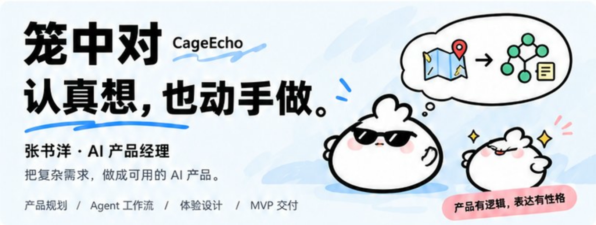
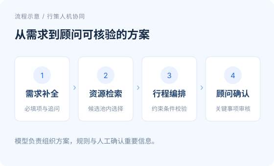
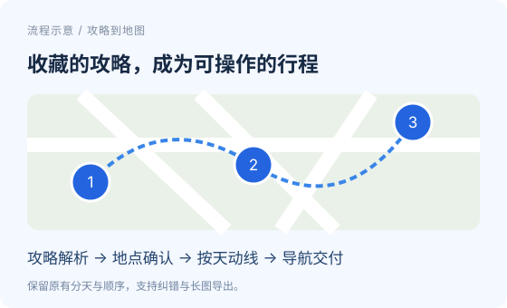
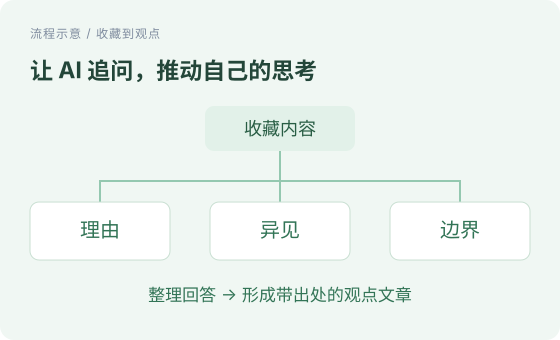

  

  
  &nbsp;
  

  <a href="#selected-work">主要项目</a> ·
  <a href="#personal-page">个人网页</a> ·
  <a href="#how-i-build">产品能力</a> ·
  <a href="https://www.xiaohongshu.com/user/profile/5c34365e0000000005039502">小红书 · 笼中对</a>

## 关于我 / ABOUT

我是 **张书洋 / CageEcho**，AI 产品经理。10+ 年互联网经验，从交互设计走向产品管理与 AI 产品实践。

关注业务场景中的 **Agent、人机协同与交付验证**，把需求落为 PRD、交互原型与可运行 Demo，连接业务、体验与技术。

| 🔎 观察问题 | 🧩 拆开机制 | 📦 做出产品 |
| :---: | :---: | :---: |
| 看见真实的需求和场景 | 找到关键变量与路径 | 让想法落地为可用的方案 |

## 主要项目 / SELECTED WORK

从真实业务到个人实践，让作品说明判断。

<table>
<tr>
<td width="50%" valign="top">
<h3>01 · 🧭 行策</h3>
<strong>高端定制旅行方案生成平台</strong>

把分散的需求、资源与顾问经验，组织成可编辑、可核验的旅行方案。

<code>Agent 工作流</code> <code>知识检索</code> <code>顾问确认</code>

<strong>120 → 35 分钟</strong> · 方案初稿耗时 <strong>43% → 67%</strong> · 方案一次通过率

30 组脱敏历史需求内部测试，数据来自项目简历。

负责产品定位、MVP 规划、PRD、交互原型、人机分工与评测设计。当前开源版本使用模拟资源数据。

<a href="https://github.com/CageEcho/xingce-travel-planner">查看项目 ↗</a>
</td>
<td width="50%" valign="middle">

</td>
</tr>
</table>

<table>
<tr>
<td width="50%" valign="top">
<h3>02 · 📖 途书旅记</h3>
<strong>AI 旅行攻略与地图动线助手</strong>

把收藏的攻略，变成可查看、可导航、可分享的出行方案。

<code>地点抽取</code> <code>POI 匹配</code> <code>人工确认</code>

<strong>按天地图 · 导航入口 · 长图导出</strong>

负责“攻略到地图”的产品流程与首版交付，设计地点纠错、分天调整、异常处理和验收标准。

首版应用已交付 / 个人项目。演示与实时能力的边界见项目文档。

<a href="https://github.com/CageEcho/Tushu-Travel-book">查看项目 ↗</a>

</td>
<td width="50%" valign="middle">

</td>
</tr>
</table>

<table>
<tr>
<td width="50%" valign="top">
<h3>03 · 🌳 知树</h3>
<strong>AI 原生个人知识树 · 知乎黑客松</strong>

让收藏长成自己的观点，用理由、异见与边界三轮追问，把思考整理为带出处的文章。

<code>需求验证</code> <code>产品定义</code> <code>冷启动</code>

<strong>48 小时</strong> · Demo 交付 <strong>188 人</strong> · 路演种子用户

708 支队伍中入围线下总决赛，赛事与转化数据来自项目简历。

担任 4 人团队产品负责人，负责调研、PRD、分工排期、Demo 开发与路演。当前公开版为本地流程演示，未接入在线 AI。

<a href="https://github.com/CageEcho/zhihu-zhishu">查看项目 ↗</a>
</td>
<td width="50%" valign="middle">

</td>
</tr>
</table>

  
  
  

<a href="https://github.com/CageEcho?tab=repositories">查看全部仓库 ↗</a>

## 产品能力 / HOW I BUILD

| 能力 | 我关注的事 |
| --- | --- |
| **产品规划** | 从业务目标定义用户、核心任务和 MVP，按价值、成本与风险安排优先级。 |
| **Agent 工作流** | 串联需求补全、工具调用、结构化抽取、用户确认与 Fallback，明确人机分工。 |
| **知识与评测** | 设计知识字段、来源标注和更新机制，用场景评测与 Bad Case 归因推动迭代。 |
| **体验与交付** | 把需求落为 PRD、交互原型和可运行 Demo，覆盖关键状态、异常路径与验收。 |

## 个人网页 / PERSONAL PAGE

个人网页正在筹备，将集中展示产品案例、演示入口与实践复盘。正式地址确认后，这里的入口会同步开放。

## 笼中对 / 思考与表达

| 🤖 AI 产品 | 📄 产品拆解 | 📊 公开构建 |
| :---: | :---: | :---: |
| 从需求到交付 | 理解机制与体验 | 记录思考与复盘 |

<a href="https://www.xiaohongshu.com/user/profile/5c34365e0000000005039502">小红书 · 笼中对 ↗</a>

小红书记录思考，GitHub 承接作品。 让想法冲出笼子，让作品留下回声。

