  

  
  &nbsp;
  

  <code>01</code> <a href="#about">关于</a> &nbsp;·&nbsp;
  <code>02</code> <a href="#selected-work">作品</a> &nbsp;·&nbsp;
  <code>03</code> <a href="#how-i-build">产品能力</a> &nbsp;·&nbsp;
  <code>04</code> <a href="#contact">联系</a>

<a href="https://sbdn49ebov6bsukfs2496.apigateway-cn-beijing.volceapi.com/">在线工作台 ↗</a> &nbsp;·&nbsp; <a href="https://github.com/CageEcho/xingce-travel-planner">开源代码 ↗</a>&nbsp;&nbsp;

<a href="https://smmsnmesmo34k7l4t9e6g.apigateway-cn-beijing.volceapi.com/">在线体验 ↗</a> &nbsp;·&nbsp; <a href="https://github.com/CageEcho/Tushu-Travel-book">开源代码 ↗</a>&nbsp;&nbsp;

<a href="https://s4un71nck60neho2ichmh.apigateway-cn-beijing.volceapi.com/">在线 Demo ↗</a> &nbsp;·&nbsp; <a href="https://github.com/CageEcho/zhihu-zhishu">开源代码 ↗</a>&nbsp;&nbsp;

  
  
  
   <a href="https://github.com/CageEcho?tab=repositories">查看全部仓库 ↗</a>

  <a href="https://cageecho.github.io/">个人网页 ↗</a> &nbsp;·&nbsp;
  <a href="https://cageecho.github.io/assets/zhangshuyang-ai-pm-resume.pdf">下载简历 ↗</a> &nbsp;·&nbsp;
  <a href="https://www.xiaohongshu.com/user/profile/5c34365e0000000005039502">小红书 · 笼中对 ↗</a>

